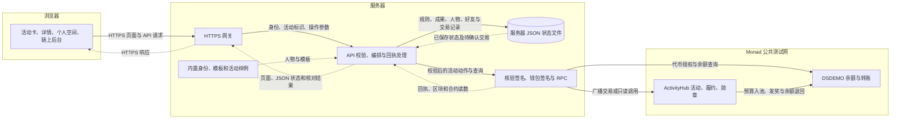
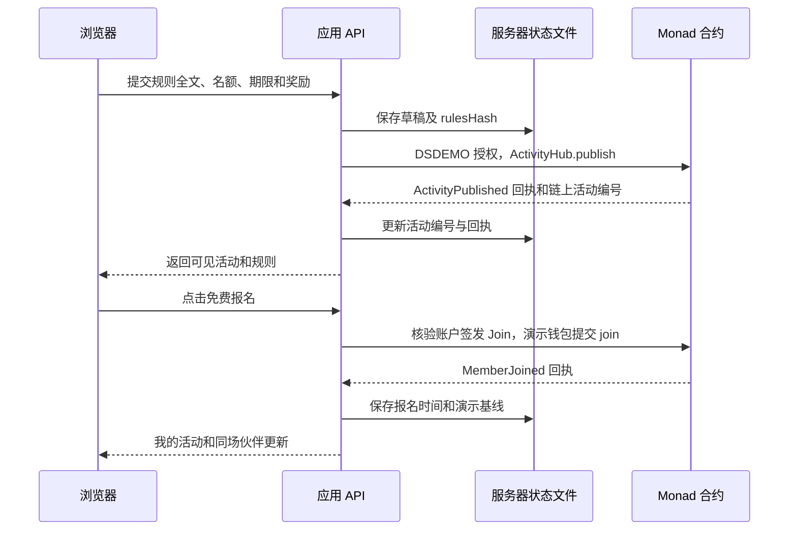
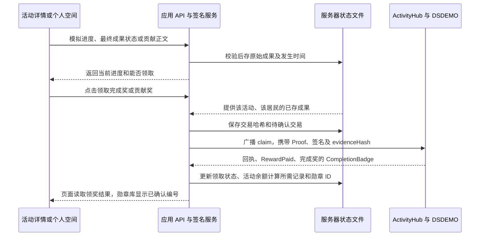
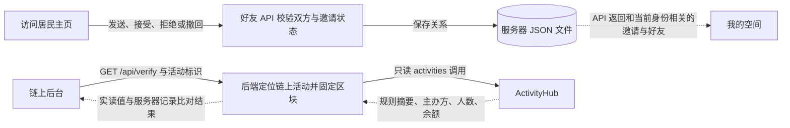

# Do Something 原型架构与数据流

当前原型包含多活动发布、报名、模拟成果、链上奖励、个人空间和好友邀请。以下图可直接在 GitHub 阅读。要切换流程或点击节点，可在本机用浏览器打开[交互版](index.html)，也可运行 `npm run preview` 后访问 `http://127.0.0.1:4173`。

每个操作的请求、存储、上链参数和回执字段见[操作字段](operation-fields.md)。

## 托管架构

部署后，浏览器通过 HTTPS 域名加载页面并调用同域 API。HTTPS 网关把请求转发到服务器的 Node.js 应用，应用核验演示访问口令、执行规则与签名流程。[服务器部署指南](deployment.md) · [应用后端](../scripts/prototype-server.mjs)

后端把规则全文、模拟进度、书评、人物和好友记录写到 `PROTOTYPE_STATE_PATH` 指定的持久化文件。需要上链时，后端用演示钱包签交易，通过 RPC 发给 Monad 公共测试网，再把确认结果回传给浏览器。测试网记录报名、测试代币余额和勋章归属。[应用 API](../scripts/prototype-server.mjs) · [测试网调用](../scripts/prototype-chain.mjs)

## 模块关系

实线箭头表示请求、调用或写入。虚线箭头表示读取的数据或返回结果。

浏览器使用 `app.js` 控制活动预览与开门，`pixels.js` 渲染同一角色在活动页和个人空间的外观。上传或绘制完成后，只将转换后的 32 × 32 像素数据写入服务器状态文件。选好的 `as` 是演示身份。后端把身份映射到服务器演示钱包，并按身份整理页面数据。核验账户签的是报名或领取凭证，演示钱包签的是发送到 Monad 的交易。[浏览器请求](../prototype/app.js) · [应用 API](../scripts/prototype-server.mjs) · [签名与合约调用](../scripts/prototype-chain.mjs#L13)

## 发布活动与报名

每场预算等于名额乘以每人可领的完成奖与贡献奖总和。活动规则全文留在服务器，合约保存摘要与可执行条件，如名额、时间和门槛。奖励领取截止后，主办方可取回本场未使用奖励。每场活动以独立的链上活动编号记账，同一个钱包可以报名多个活动。[发布与报名](../scripts/prototype-server.mjs) · [活动合约](../contracts/ActivityHub.sol#L79)

## 模拟成果怎样变成链上奖励

合约核对钱包、报名、时间、签名、奖励类别和领取次数。完成奖还核对分数和活动设置的最终成果条件，并在同一笔交易派奖与铸造不可转让勋章。贡献奖只派奖。共读样例的 80% 与正文末章是活动规则，数据来自模拟提交。未来接入微信读书后，实际阅读事实还需要授权数据来源和核验。[模拟成果与领取](../scripts/prototype-server.mjs) · [链上校验](../contracts/ActivityHub.sol#L103)

## 好友和链上核对各走哪条路径

普通页面状态由服务器记录与已确认回执汇总，钱包余额直接读代币合约。后台交易列表按后端提交的哈希追踪回执。页面的「读取合约并核对」再对指定活动和区块直接查询合约。好友操作和成果同步写入服务器存储。[应用后端](../scripts/prototype-server.mjs)

## 数据落点

| 数据 | 来源 | 保存位置与使用方式 |
| --- | --- | --- |
| 虚拟居民与活动模板 | 内置目录 | 后端读取目录，页面以 `as` 选择演示身份 |
| 规则全文、样例进度、贡献正文 | 发布者或参与者的页面输入 | 服务器状态文件，详情、核验与社交展示读取 |
| 邀请与好友状态 | 居民主页上的动作 | 服务器状态文件，API 按演示身份返回 |
| 自定义像素人物 | 浏览器转换后的 32 × 32 RGBA 数据 | 服务器状态文件，活动页和个人空间共同读取 |
| 规则摘要、名额、时间、门槛、活动预算 | 发布时从规则派生 | `ActivityHub`，用于报名和领奖条件判断 |
| 报名、领取标记、勋章归属 | 已确认链上交易 | `ActivityHub`，后端按回执更新展示记录 |
| 成果摘要和测试代币转账 | 后端核验凭证与奖励调用 | Monad 领取交易及相关合约事件，`DSDEMO` 余额由代币合约维护 |
| 交易哈希与回执状态 | 演示钱包签名、Monad RPC 回执 | 服务器状态文件，链接至区块浏览器 |
